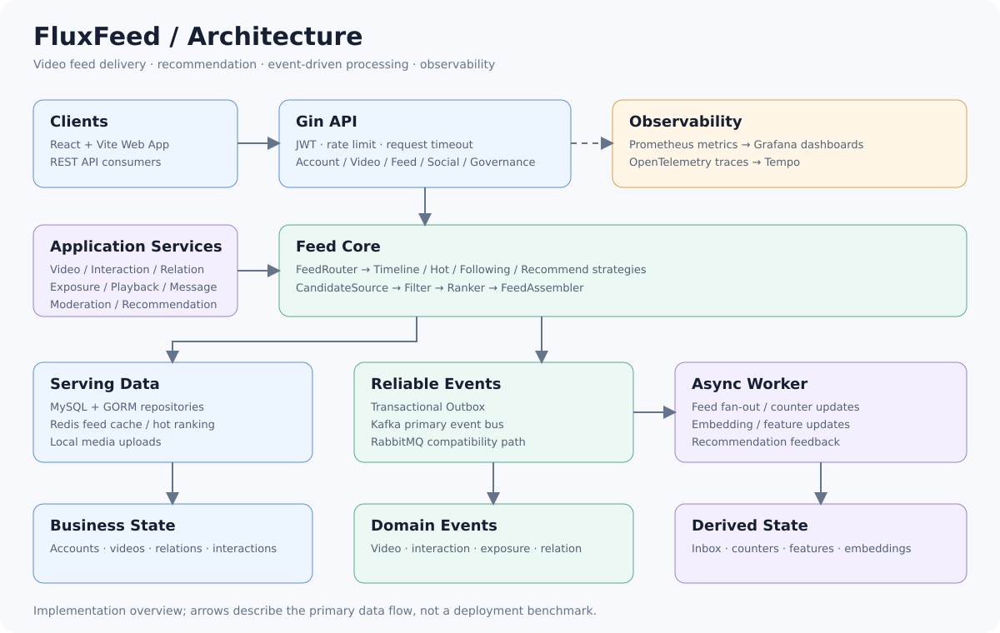
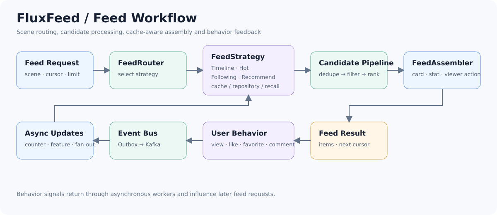

<p align="center">
  <strong>FluxFeed</strong><br/>
  高并发个性化视频 Feed 系统 · 从内容供给到行为反馈的完整闭环
</p>

<p align="center">
  
  
  
  
  
</p>

# FluxFeed｜高并发视频 Feed 分发系统

FluxFeed 基于 Go 与 React 构建，围绕「内容供给 → Feed 分发 → 用户消费 → 行为反馈」实现短视频业务闭环。核心包括可扩展 Feed Engine、多场景候选策略、Redis 缓存、Kafka + Outbox 可靠事件、互动与社交关系、内容治理，以及 Prometheus / Grafana / Tempo 可观测性。

[](docs/architecture.md)

<p align="center">
  <a href="#快速开始">快速开始</a> ·
  <a href="#核心工作流">核心工作流</a> ·
  <a href="docs/architecture.md">架构设计</a> ·
  <a href="#工程与观测">工程与观测</a> ·
  <a href="docs/performance-testing.md">性能测试</a>
</p>

## 产品预览

<p align="center">
  
</p>

Web 客户端覆盖登录注册、沉浸式 Feed、点赞收藏评论、关注关系、个人主页、消息通知与视频发布，并接入播放配置、后续视频预加载和 QoS 上报。

## 项目能力

| 能力 | 实现方式 |
| --- | --- |
| 多场景 Feed | `FeedRouter` 按场景路由 Timeline、Hot、Following、Recommend 策略 |
| 候选处理 | `CandidateSource → Filter → Ranker → FeedAssembler`，统一去重、排序与卡片水合 |
| 高性能读取 | Redis Feed 缓存、视频卡片与计数缓存、分钟桶热榜，数据库缺失回源 |
| 可靠事件 | Transactional Outbox + Kafka；Worker 消费视频、互动、曝光和关系事件 |
| 推荐闭环 | 候选召回、排序打散、曝光去重、行为事件与特征更新 |
| 业务闭环 | 账户、视频、互动、关注、消息、播放优化、举报与申诉 |
| 内容治理 | title / video / cover 规则预审、人工终审、上下架、封禁、角色权限与审计日志 |
| 可观察性 | Prometheus 指标、Grafana 看板、OpenTelemetry Trace 与 Tempo |

## 核心工作流

### 1. 从 Feed 请求到视频卡片



请求携带 `scene`、`cursor` 与 `limit` 进入 Feed Service。`FeedRouter` 选择场景策略，候选经过获取、去重、过滤与排序后，由 `FeedAssembler` 批量装配视频卡片、互动计数和当前用户状态。浏览、点赞、收藏与评论继续形成反馈事件，驱动后续计数、特征和 Feed 状态更新。

### 2. 同步服务与异步事件

API 负责需要即时响应的账户、视频、Feed、关系和治理操作；事件通过 Outbox 与业务写入保持一致，再由 Worker 消费 Kafka Topic，完成 Feed fan-out、互动计数、特征与 embedding 更新。RabbitMQ 保留为兼容事件通道。

> 架构图表示当前代码的主要实现关系，不代表生产容量承诺。压测方法与验收结果见 [性能测试](docs/performance-testing.md) 和 [性能验收报告](docs/performance-acceptance-2026-09-29.md)。

## 快速开始

### 环境要求

- Docker 与 Docker Compose
- 本地开发可选：Go 1.25.4、Node.js 20+

### Docker Compose 启动

```bash
cp .env.example .env
# 编辑 .env，将所有 GENERATE_* 值替换为随机值

cd apps
docker compose --env-file ../.env up -d --build
```

`ADMIN` 与 `ADMIN_PW` 是管理后台的启动账号。API 每次启动都会幂等创建该账号（已存在时同步密码与管理员权限），登录成功后自动进入 `/admin`。部署环境请务必使用随机强密码，不要沿用本地开发值。

启动后访问：

| 服务 | 地址 |
| --- | --- |
| Web | `http://127.0.0.1:5173` |
| API / Health | `http://127.0.0.1:8080` / `http://127.0.0.1:8080/health` |
| Metrics | `http://127.0.0.1:8080/metrics` |
| RabbitMQ | `http://127.0.0.1:15672` |
| Prometheus | `http://127.0.0.1:9090` |
| Grafana | `http://127.0.0.1:13000` |
| Tempo | `http://127.0.0.1:3200` |

停止服务：

```bash
cd apps
docker compose --env-file ../.env down
```

密钥注入、Kubernetes Secret 创建和轮换流程见 [Secrets Management](docs/secrets-management.md)。

### 本地开发

```bash
# 安装依赖并启动 API、Worker 与 Web
make deps
make deps-web
make dev
```

也可以分别运行 `make run-api`、`make run-worker` 与 `make web-dev`。API 默认读取 `apps/api/configs/config.yaml`；本地运行前请准备 MySQL、Redis 与 Kafka，并填入所需密钥。

`make dev` 会加载项目根目录 `.env`，因此同样可通过 `ADMIN`、`ADMIN_PW` 创建或更新本地管理员。

## 工程与观测

### 代码结构

```text
FluxFeed/
├── apps/api/                  # Go API、Worker、领域与基础设施实现
│   ├── cmd/feed/              # HTTP 服务入口
│   ├── cmd/worker/            # 异步消费者入口
│   └── internal/              # domain / application / interfaces / infra
├── apps/web/                  # React + Vite Web 客户端
├── apps/monitoring/           # Prometheus、Grafana、Tempo 配置
├── docs/                      # 架构、模块、性能与工程文档
└── scripts/                   # 压测、造数与诊断脚本
```

### 常用命令

| 命令 | 说明 |
| --- | --- |
| `make dev` | 本地启动 API + Worker + Web |
| `make build` / `make build-web` | 构建后端二进制 / Web 静态资源 |
| `make test` / `make test-race` | 运行 Go 测试 / 竞态检测 |
| `make cover` | 生成 `build/coverage.out` |
| `make fmt-check` / `make vet` / `make lint` | 格式、静态分析与 lint |
| `make up` / `make down` / `make logs S=api` | 全栈启停与日志 |
| `make clean` | 停止容器并删除普通、性能环境的全部数据卷 |
| `make clean-build` | 清理构建产物与 Go 测试缓存 |
| `make ci` | 格式检查 + vet + 测试 + 构建 |

完整后端校验：

```bash
cd apps/api
go test ./...
```

前端构建：

```bash
npm --prefix apps/web run build
```

### 可观测性

API 暴露 Prometheus 指标，仓库内置 Feed 延迟、缓存、推荐、Kafka、fan-out、MySQL 与错误率等 Grafana Dashboard。HTTP 与异步链路通过 OpenTelemetry 上报到 Tempo，用于跨组件定位慢请求和事件消费问题。

## 技术栈

| 领域 | 技术 |
| --- | --- |
| Backend | Go 1.25.4 / Gin / GORM |
| Frontend | React 18 / Vite 5 |
| Database | MySQL |
| Cache | Redis |
| Event Bus | Kafka / RabbitMQ（兼容）/ Transactional Outbox |
| Observability | Prometheus / Grafana / OpenTelemetry / Tempo |
| Load Test | k6 |
| Deployment | Docker Compose / Kubernetes manifest |

## 文档导航

| 文档 | 内容 |
| --- | --- |
| [Quick Read](docs/quickread.md) | 项目能力与阅读入口 |
| [Architecture](docs/architecture.md) | 系统边界、分层与核心链路 |
| [Feed Core Upgrade](docs/stage2-feed-core-upgrade.md) | Feed Engine 重构说明 |
| [Product](docs/product.md) | 产品范围与模块地图 |
| [Modules](docs/modules/README.md) | 各业务模块设计 |
| [Engineering](docs/engineering.md) | 工程规范与分层约定 |
| [Performance Testing](docs/performance-testing.md) | k6 压测与指标分析 |
| [Secrets Management](docs/secrets-management.md) | 密钥注入、创建与轮换 |

## License 与来源说明

FluxFeed 基于 GCFeed 项目进行二次开发。原项目已有的版权、License 与作者归属应继续保留；FluxFeed 的改造重点为 Feed Core 架构、高并发分发、缓存、可靠事件、推荐反馈与系统治理。
